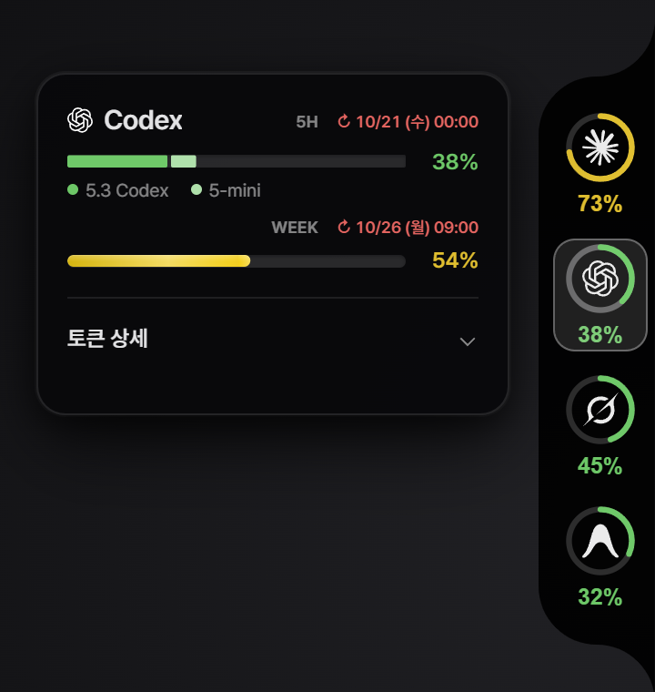
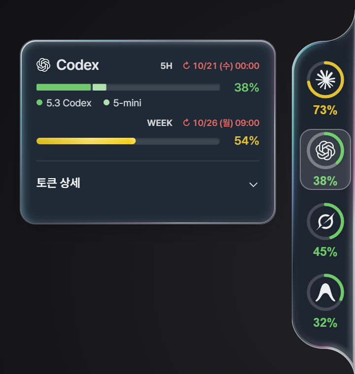
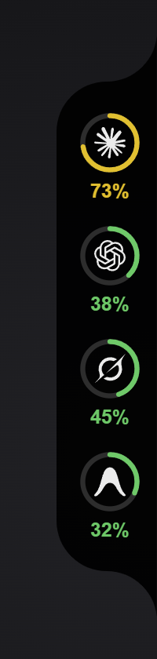
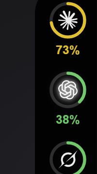
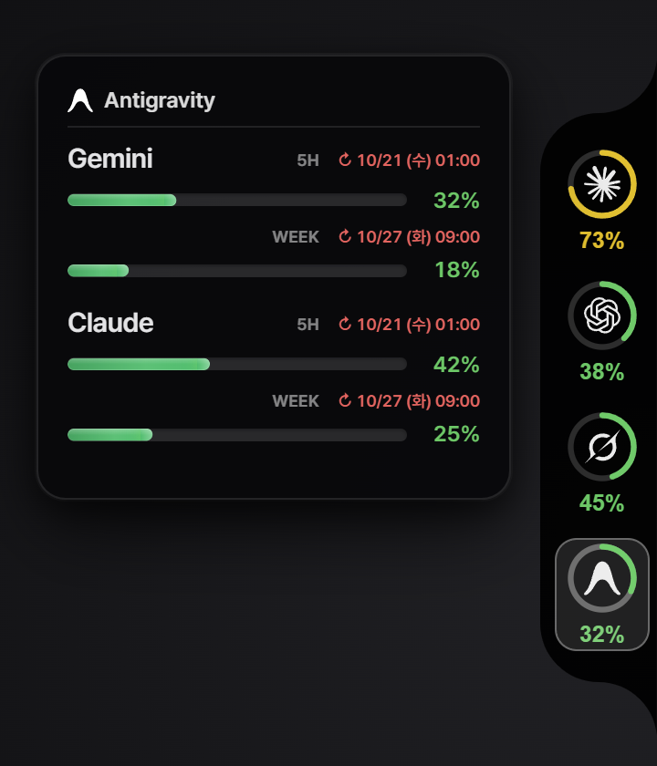
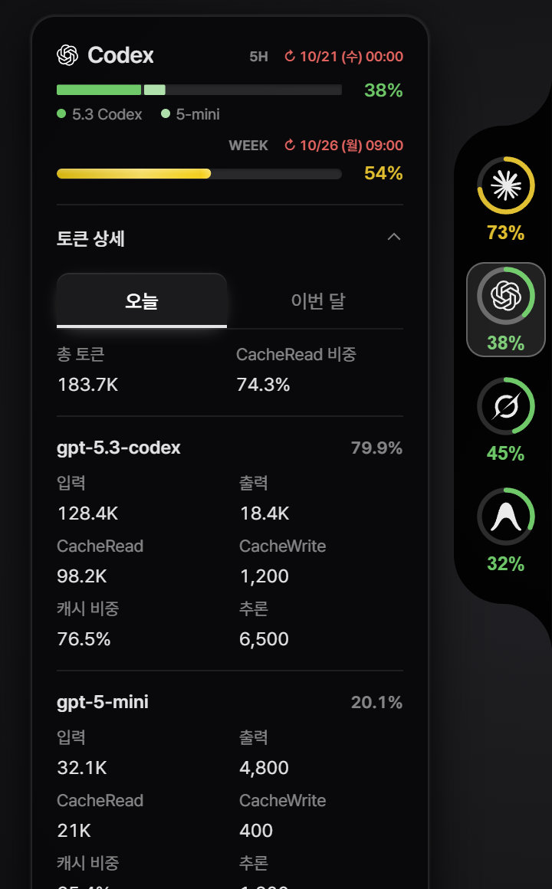
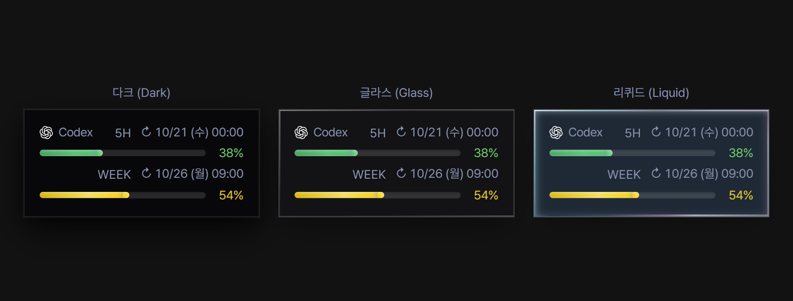
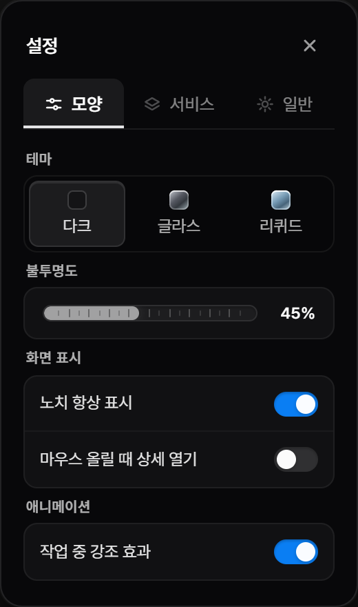
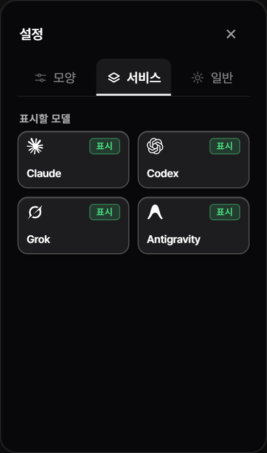
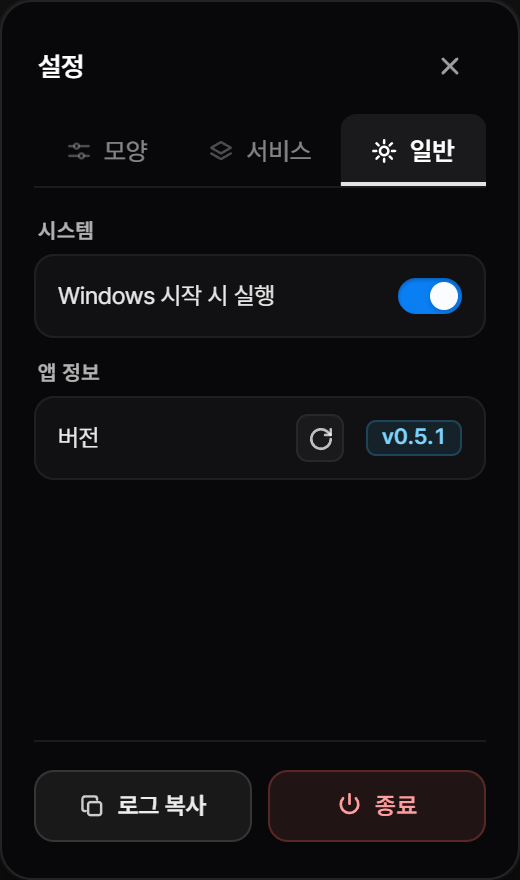

# Token Usage

> **Windows 화면 가장자리에 자연스럽게 밀착되는 AI 코딩 쿼터 & 토큰 모니터**  
> *Claude Code · OpenAI Codex · xAI Grok · Google Antigravity의 잔여 한도와 실시간 작업 상태를 단 하나의 에지 노치에서 확인하세요.*

<p align="center">
  <a href="https://github.com/sky64422/TokenUsage/releases/latest">
    
  </a>
</p>

<p align="center">
  
  &nbsp;
  
</p>
<p align="center">
  <em>▲ 다크 테마 (좌) &nbsp;·&nbsp; 리퀴드 글라스 테마 (우)</em>
</p>

---

## 최신 UI/UX 핵심 기능 (Features)

### 1. 화면 에지 노치 & 라이브 액티비티 (Edge Notch & Live Activity)
화면 4면 모서리(상·하·좌·우) 어디든 자연스럽게 밀착되는 오목한 곡면(Concave SVG) 노치입니다. 하단에 배치할 경우 Windows 작업표시줄 위를 자연스럽게 오버레이합니다.

- **단일 연속형 서머리 링**: 끊김 없는 40 DIP 원형 트랙과 정밀한 사용량 아크, 중앙의 공식 브랜드 심볼 마크로 잔여 한도를 직관적으로 표시합니다.
- **라이브 액티비티 궤도 회전**: AI 에이전트가 코딩 작업 중일 때 아이콘 주위 궤도가 회전하며 작업 상태를 실시간으로 알립니다.
- **자동 접힘 및 호버 확장**: 마우스를 떼면 얇은 에지 탭으로 자동 접히며, 마우스를 올리면 180ms 이탈 유예 시간과 함께 부드럽게 펼쳐집니다. (고정을 원할 경우 `노치 항상 표시` 옵션 지원)
- **모니터 반응형 스케일링**: 디스플레이 해상도 및 배율(DPI)에 맞춰 노치 크기와 글꼴이 이상적인 비율로 자동 조절됩니다.

| 에지 노치 (평상시) | 모델 작업 중 (Live Activity) |
|:---:|:---:|
|  |  |

---

### 2. 콰이어트 럭셔리 상세 쿼터 창 (Quiet Luxury Quota Detail)
아이콘을 클릭하거나 마우스를 올리면 화면 안쪽으로 정밀한 쿼터 카드가 펼쳐집니다.

- **Quiet Luxury 7px 진행바**: 과도한 장식을 배제한 7px 높이의 정밀 트랙과 진행률에 따른 4단계 위험도 컬러 (0–50% 초록, 51–75% 노랑, 76–90% 주황, 91%+ 빨강).
- **진행바 내부 러닝 라이트**: 모델이 활발하게 연산 중일 때 채워진 진행바 영역 내부에서만 은은한 조명 효과가 흐릅니다.
- **고유 컨텐츠 적응형 높이 (Intrinsic Height)**: 세부 내역을 펼쳐도 창이 덜컹거리거나 위치가 튀지 않도록 네이티브 캔버스 공간을 사전에 예약하여 매끄럽게 확장됩니다.
- **멀티 윈도우 & 그룹 분리**: 5시간 롤링 한도, 주간 리필 카운트다운(`↻ 3h 12m`), Antigravity의 Gemini / Claude 모델 패밀리 그룹을 명확하게 구분하여 제공합니다.

| 단일 / 듀얼 쿼터 (Codex) | 멀티 그룹 쿼터 (Antigravity AGY) |
|:---:|:---:|
|  |  |
| *5시간 롤링 한도 & 주간 쿼터* | *Gemini / Claude 패밀리 분리 표시* |

---

### 3. 세션 토큰 상세 & 모델별 점유율 음영 (Token Details & Model Shading)
로컬에 기록된 실제 세션 로그에서 숫자와 모델 메타데이터만 안전하게 읽어와 상세 토큰 내역을 제공합니다. (대화 내용이나 프롬프트는 절대 수집·저장하지 않습니다)

- **오늘 / 이번 달 슬라이딩 탭**: 기간별 총 토큰 수와 `CacheRead` 캐시 절감 비중을 한눈에 파악할 수 있습니다.
- **메인 쿼터 바 모델별 음영 (Model Shading)**: 공식 쿼터 진행바 내부에 사용된 모델별 비중을 정교한 음영 블록으로 시각화하며, 하단에 색상 도트와 모델명 레전드가 표시됩니다.
- **정밀 컬럼 정렬**: 입력 토큰(캐시 읽기 포함)과 출력 토큰(추론 토큰 포함), CacheWrite 수치를 깔끔한 2열 그리드로 정렬합니다.

<p align="center">
  
</p>
<p align="center">
  <em>▲ 쿼터 진행바 내 모델별 음영 및 세션 토큰 상세 (오늘 / 이번 달 탭 및 모델별 입력·출력·캐시·추론 토큰)</em>
</p>

---

### 4. 3가지 테마 & 반응형 명암비 (Themes & Visual Engine)
개인의 데스크톱 환경과 취향에 맞게 세 가지 표면 테마를 제공합니다.

- **다크 (Dark)**: 정돈된 차분함과 깊은 대비를 제공하는 기본 다크 테마.
- **글라스 (Glass)**: 거울 같은 3px 미러 테두리와 은은한 반투명 스모크 글라스.
- **리퀴드 (Liquid)**: 실제 바탕화면을 실시간 샘플링하여 렌더링하는 네이티브 블러와 프리즘 반사 림(Prism rim). 밝은 배경화면에서도 가독성을 잃지 않도록 폰트 대비를 자동 전환하는 반응형 명암비(Adaptive Contrast)가 적용됩니다. (초저지연 GDI 샘플링으로 CPU 점유율 <0.1% 유지)

<p align="center">
  
</p>
<p align="center">
  <em>▲ 다크 (Dark) · 글라스 (Glass) · 리퀴드 (Liquid) 3가지 표면 테마</em>
</p>

---

### 5. 단일 공유 높이 3-탭 설정 패널 (Settings Panel)
우클릭 또는 `Shift+F10`으로 설정 패널을 열 수 있습니다. 탭을 전환해도 패널 높이가 변경되지 않는 **단일 공유 높이(Shared Height)** 계약이 적용되어 시각적 피로감이 없습니다.

- **`모양`**: 다크·글라스·리퀴드 테마 선택, 눈금 스냅을 지원하는 정밀 불투명도 슬라이더, 노치 항상 표시, 마우스 올릴 때 상세 열기, 작업 중 강조 효과(궤도 및 발광) 토글.
- **`서비스`**: 사용하는 AI 도구만 선택적으로 켜고 끄는 직관적인 그리드 (최소 1개 활성화 보호).
- **`일반`**: Windows 시작 시 자동 실행, 인라인 업데이트 확인 및 원클릭 재시작, 클립보드 진단 로그 복사, 오작동을 방지하는 2단계 확인 종료 버튼.

| 모양 (Appearance) | 서비스 (Services) | 일반 (General) |
|:---:|:---:|:---:|
|  |  |  |
| *테마 · 불투명도 · 항상 표시 · 호버 열기* | *사용 중인 AI 서비스만 맞춤 표시* | *시작 시 실행 · 원클릭 업데이트 · 로그 복사* |

---

## 조작법 (Controls)

| 조작 | 기능 |
|:---|:---|
| 🖱️ **클릭** | 상세 쿼터 카드 열기 / 닫기 (고정 핀) |
| ✋ **드래그** | 화면 4면 모서리(상·하·좌·우) 및 다른 모니터로 이동 (하단 작업표시줄 오버레이) |
| ⚙️ **우클릭** | 3-탭 설정창 열기 (`Shift+F10`) |
| ⎋ **Esc** | 열린 쿼터 카드 또는 설정창 닫기 / 드래그 취소 |
| 📌 **트레이 아이콘** | 작업표시줄 시스템 트레이에서 보이기 / 숨기기 / 종료 |

---

## 지원 서비스 (Zero-Config Architecture)

*별도의 API 키 등록 불필요 — PC에 1회 이상 로그인된 공식 CLI 세션 및 OAuth 토큰을 자동 감지합니다.*  
*잔여 한도 메타데이터만 로컬에서 조회하므로 추가 코딩 토큰이나 비용을 전혀 소모하지 않습니다.*

- 🟣 **Claude Code** (`claude`) — 5시간 롤링 한도 & 7일 주간 쿼터
- 🟢 **OpenAI Codex CLI** (`codex`) — 5시간 한도 & 주간 쿼터 + 세션 토큰 상세
- ⚪ **xAI Grok CLI** (`grok`) — 주간 크레딧 풀 + 세션 토큰 상세
- 🔵 **Google Antigravity** (`agy`) — Gemini & Claude 쿼터 (0ms 콜드 스타트 캐시 & ConPTY 즉각 통지) + 세션 토큰 상세

---

## 빠른 시작 (Quick Start)

- **지원 환경:** Windows 10 / 11 (64-bit)
1. **[Releases](https://github.com/sky64422/TokenUsage/releases/latest)**에서 최신 설치 파일(`.exe` / `.msi`) 다운로드
2. 설치 후 실행 즉시 화면 모서리에 잔여 쿼터 자동 표시 (초기 5초 자동 동기화)

---

<details>
<summary><strong>개발자 가이드 (For Developers)</strong></summary>

```powershell
npm install
npm run tauri dev
npm test
npm run build
```

- 아키텍처 및 레이아웃 계약: [`docs/ARCHITECTURE.md`](docs/ARCHITECTURE.md)
- 프로바이더 연동 가이드: [`docs/providers.md`](docs/providers.md)
- 비주얼 시스템 및 디자인 원칙: [`DESIGN.md`](DESIGN.md)

</details>

---

## 참고 및 크레딧 (References & Credits)

- **[CodeNotch](https://github.com/vinzdg/codenotch)** — 화면 가장자리에 자연스럽게 밀착되는 에지 노치 디자인과 인터랙션 콘셉트, 그리고 Windows 환경의 Antigravity CLI ConPTY 연동 방식에 많은 영감과 참조를 받았습니다. (MIT License · [`third-party/codenotch/NOTICE.md`](third-party/codenotch/NOTICE.md))
- **[shadcn/ui](https://ui.shadcn.com)** & **[Impeccable](https://impeccable.style)** — 절제되고 정교한 Operate 모드 밀도와 시맨틱 토큰/포커스 규칙을 준수합니다.
