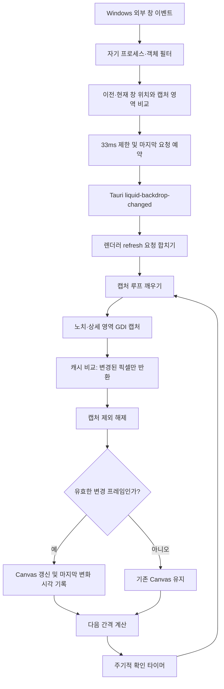

# Liquid 배경 탐지·갱신 개선

작성 기준: 2026-11-01 작업 트리. 아래 행 번호는 최초 작성 시점의 탐색용이며, 이후 변경 시 함수·상수 이름을 기준으로 찾는다. 이 문서는 구현 방향과 코드 참조점이며 릴리스 노트가 아니다.

**추가 검증:** [후속 검증 보고서](liquid-validation-report.md)에 CPU/GPU 비교, hover 스모크 수정, 두 모니터·재로드·3분 자원 관찰, 동적 배경의 외부 캡처 누락을 기록했다. 아래 최초 검증 기록보다 이 보고서의 판정을 우선한다.

**최신 상태:** [WGC 심층 검증 보고서](liquid-wgc-deep-validation.md)의 창 영역 복사 최적화 결과를 우선한다. 아래 1~7절은 GDI 공통 갱신 개선의 기록이다. 후속 WGC 구현 및 배포 전 개선 방향은 8절에 정리한다.

## 1. 목적과 채택한 방향

정지한 화면에서는 불필요한 작업을 줄이고, 노치 뒤의 창이 움직이거나 배경 픽셀이 계속 변할 때는 빠르게 반영한다.

**기존 GDI 영역 캡처를 유지하면서 단발 타이머, Windows 창 이벤트, 실제 픽셀 변화 기반 갱신 속도를 결합했다.** 캡처 엔진을 전면 교체하지 않고 현재 캐시·Canvas·네이티브 배치 구조를 활용한다. Glass와 Liquid가 공통 경로를 사용한다.

| 항목 | 개선 전 | 개선 후 |
| --- | --- | --- |
| 정지 상태의 스케줄링 | 캡처는 느려져도 rAF에서 매 프레임 시각 확인 | 다음 캡처 시점까지 단발 타이머로 대기 |
| 고속 갱신 복귀 | 주로 표시·레이아웃·포커스 등 UI 상태 변경에 의존 | 실제 변경 프레임을 그리면 고속 갱신 유지 |
| 외부 창 변화 | 다음 주기적 캡처까지 기다릴 수 있음 | Windows 이벤트를 받아 갱신 시점을 앞당김 |
| 이벤트 폭주 | 새 외부 이벤트 경로 없음 | 네이티브·프런트엔드에서 요청을 합치고 마지막 요청도 예약 |
| 연속 변화 중 캡처 제외 | 짧은 lease를 반복 갱신하면 제외 상태가 이어질 가능성 | 캡처 묶음 완료 후 `finally`에서 명시적으로 해제 |
| 캡처 파일 로그 | 캡처마다 파일 기록 경로 실행 | 환경 변수로 명시적으로 켠 경우에만 기록 |

기존의 작은 영역 캡처, GDI 버퍼 재사용, 동일 프레임 전송 생략은 유지했다. 이 단계에서 보존했던 Liquid 드래그 중 캡처 일시 중지는 후속 사용자 요청으로 변경했다. 최신 드래그 동작은 9절을 따른다.

## 2. 전체 흐름



창 이벤트는 **변화 가능성을 알려주는 힌트**다. 실제 화면이 바뀌었는지는 기존 픽셀 캐시 비교로 판단한다. 이벤트만 계속 발생한다고 고속 상태를 계속 연장하지 않는다.

## 3. 갱신 정책

정상 상태에서 마지막 변경 프레임 또는 표시·배치 전환 시점을 기준으로 간격을 선택한다.

| 조건 | 목표 간격 | 비고 |
| --- | --- | --- |
| 변화 후 150ms 미만 | 약 33.3ms, 30회/초 | 변경 프레임을 그릴 때 기준 시각 갱신 |
| 변화 후 150ms 이상, 400ms 미만 | 100ms, 10회/초 | 안정화 구간 |
| 변화 후 400ms 이상 | 1,000ms, 1회/초 | 창 이벤트가 없는 변화도 탐지하기 위한 주기적 확인 |
| Windows 동작 줄이기 | 250ms, 4회/초 | 정상 주기보다 우선 |
| Liquid 드래그 | 캡처 중지 | 드래그 종료 후 다시 캡처 |
| Glass 드래그 | 약 16.7ms, 60회/초 | 동작 줄이기가 켜져 있으면 250ms 정책 우선 |

이 수치는 목표 간격이다. 브라우저 타이머·화면 프레임·IPC·DWM·캡처 시간에 따라 실제 간격은 달라진다. 할당량을 가져오는 **공급자 polling 5초**와는 별개의 정책이다.

## 4. 구현 상세와 코드 참조점

### 4.1 단발 타이머와 캡처 직렬화

[src/ui/liquid-loop.ts](../src/ui/liquid-loop.ts)의 `createLiquidLoop`가 스케줄링과 수명주기를 담당한다.

| 참조점 | 역할 |
| --- | --- |
| `schedule()` — 19행 | `due`까지 타이머로 기다리고, 기한에 rAF 한 번 요청 |
| `tick()` — 32행 | 중복 캡처를 막고 한 번의 비동기 캡처 실행 |
| `busy` | 진행 중인 캡처가 있으면 새 캡처를 겹쳐 실행하지 않음 |
| `epoch` | 테마 중지·재시작 이전의 늦은 결과를 그리지 않음 |
| `refresh()` | 예약을 앞당김. 캡처 중 요청은 다음 실행으로 합쳐짐 |
| `cancelScheduled()` / `destroy()` | 중지 시 타이머와 rAF 취소 |

캡처가 오래 걸려도 밀린 프레임을 큐에 쌓아 따라잡지 않는다. 완료 후 다음 간격을 다시 계산하므로, 변경 픽셀이 도착하면 빠른 주기로 돌아갈 수 있다.

### 4.2 실제 픽셀 변화와 렌더러 상태

[src/ui/liquid-glass.ts](../src/ui/liquid-glass.ts)의 `mountLiquidGlass`가 화면 상태와 캡처 루프를 연결한다.

| 참조점 | 역할 |
| --- | --- |
| 13~19행의 간격 상수 | 30/60/4/10/1회 정책과 150/400ms 전환 기준 |
| 루프의 `interval` 콜백 — 119행 부근 | 동작 줄이기·드래그·변화 경과 시간으로 다음 간격 선택 |
| 루프의 `paint` 콜백, `lastChangedAt = now` — 177행 | 유효한 변경 프레임을 그렸을 때 고속 갱신 기준 갱신 |
| `sync()` | 표시 여부, 접힘, 상세 표시, 드래그 상태를 루프에 반영 |
| `capture()` — 326행 | 보이는 표면을 캡처하고 크기·세대가 달라진 결과 제외 |
| 공개 `refresh()` — 369행 | 외부 창 이벤트를 합치고 마지막 요청을 타이머에 보존 |
| `relayout()` | 레이아웃 세대 갱신과 즉시 재캡처 요청 |

`lastCaptureAt`과 `lastEventRefresh`를 사용해 외부 이벤트가 들어올 때마다 무제한으로 캡처하지 않도록 한다. 이벤트 타이머가 이미 있으면 새 타이머를 쌓지 않는다. 숨김·Liquid 드래그·파괴 시 예약을 취소한다.

### 4.3 Windows 창 이벤트

[src-tauri/src/infrastructure/liquid_events.rs](../src-tauri/src/infrastructure/liquid_events.rs)가 새로 추가된 네이티브 이벤트 모듈이다.

- `start()`: 별도 메시지 루프 스레드에 `SetWinEventHook` 등록.
- `changed()`: foreground, show, hide, destroy, location-change 이벤트 처리.
- `WINEVENT_SKIPOWNPROCESS`: 자기 프로세스 이벤트 제외.
- `OBJID_WINDOW`, `GetAncestor(..., GA_ROOT)`: 창 단위 이벤트로 범위를 좁힘.
- `overlaps()`: 외부 창의 이전·현재 위치와 캡처 영역의 겹침 확인. 창이 영역 밖으로 빠져나간 경우도 이전 위치로 탐지.
- `previous`: HWND별 이전 사각형을 최대 512개 보관. 한도에서 캐시를 비워 메모리 증가 방지.
- 이전 위치를 모르는 창은 보수적으로 갱신. 필터링 정보가 없다고 변화를 놓치지 않음.
- `EVENT_INTERVAL = 33ms`: 이벤트 전달 빈도 제한. 제한 중 마지막 요청은 `SetTimer`와 `trailing()`으로 전달.
- 등록 실패 시 오류를 출력하고 기존 주기적 캡처로 계속 동작.

연결 지점:

| 파일 | 참조점 |
| --- | --- |
| [src-tauri/src/lib.rs](../src-tauri/src/lib.rs) | 64행: `liquid_events::start` 호출 |
| [src-tauri/src/infrastructure/liquid_capture.rs](../src-tauri/src/infrastructure/liquid_capture.rs) | 159행: 실제 캡처 위치를 `record_region`에 기록 |
| [src/ui/app.ts](../src/ui/app.ts) | 146행: `liquid-backdrop-changed` 구독 → `liquidGlass.refresh()` |
| [src-tauri/Cargo.toml](../src-tauri/Cargo.toml) | 기존 `windows` crate에 `Win32_UI_Accessibility` 기능 추가 |

### 4.4 캡처·캐시·캡처 제외

[liquid_capture.rs](../src-tauri/src/infrastructure/liquid_capture.rs)의 `CaptureWorker`, `Surface::read`, `FrameCache::frame`은 기존 캡처 기반이다. `BitBlt`로 필요한 영역을 읽고, 동일 키·동일 픽셀이면 빈 결과를 반환해 RGBA 전송과 다시 그리기를 생략한다. **동일 여부를 확인하는 캡처 자체는 수행한다.**

[liquid_glass.rs](../src-tauri/src/infrastructure/liquid_glass.rs)의 `capture_liquid_backdrop`은 자신을 배경으로 다시 읽지 않도록 일시적으로 `WDA_EXCLUDEFROMCAPTURE`를 적용한다. `InFlight`와 `release_liquid_backdrop`은 읽기 도중 제외 상태가 풀리지 않도록 조정한다. 기존 80ms lease와 감시 경로는 복구 장치로 남아 있다.

프런트엔드 `capture()`의 `finally`에서 `release_liquid_backdrop`을 기다리도록 했다. 보이는 노치·상세 표면의 캡처 묶음이 끝날 때 해제하므로, 연속 영상의 고속 캡처가 rolling lease를 무기한 갱신하는 문제를 방지한다. 캡처 중인 짧은 구간까지 외부 스크린샷에 항상 표시된다는 보장은 아니다.

### 4.5 파일 로그

[capture_log.rs](../src-tauri/src/infrastructure/capture_log.rs)의 `log_event`는 `OnceLock`으로 `TOKENUSAGE_CAPTURE_DEBUG=1` 여부를 한 번 확인한다. 기본 실행에서는 캡처 파일 로그를 기록하지 않는다.

```powershell
# 프로세스 시작 전에 설정. 진단 후 변수 없이 재시작한다.
$env:TOKENUSAGE_CAPTURE_DEBUG = '1'
```

파일: `%LOCALAPPDATA%/TokenUsage/logs/capture-debug.log`. 기존 약 2MiB 크기 제한을 유지한다. 자세한 실행 안내는 [windows-dev.md](windows-dev.md)를 참고한다.

## 5. 검증과 관찰 결과

아래는 이번 구현 작업에서 실행한 결과다. 이 문서 작성 시 테스트를 새로 실행한 것은 아니며, 코드와 저장된 결과 파일을 다시 확인했다.

| 검증 | 결과 |
| --- | --- |
| `npm test` | UI 109개, Rust lib 125개, risk 19개, liquid frames 3개, notch 28개 통과. Rust lib 1개 ignored |
| `npm run build` | 통과 |
| `git diff --check` | 통과 |
| `python -X utf8 scripts/settings-smoke.py` | 통과. Vite 1420 필요 |
| [liquid-scheduling-smoke.py](../scripts/liquid-scheduling-smoke.py) | 실제 Canvas + 합성 픽셀 + 가상 시간으로 주기·드래그·종료 검증 |
| [liquid-events-native-smoke.py](../scripts/liquid-events-native-smoke.py) | 별도 preview에서 실제 Windows 배경 창·이벤트·픽셀·캡처 제외 확인 |
| 기존 `native-quality-smoke.py` | 최초에는 합성 hover 검사 실패. 후속 검사에서 실제 커서 경로로 수정 후 세 테마 모두 통과. 위 추가 보고서 참고 |

단위 테스트 참조: [liquid-loop.test.ts](../src/ui/liquid-loop.test.ts), [liquid-glass.test.ts](../src/ui/liquid-glass.test.ts), [liquid_frames.rs](../src-tauri/tests/liquid_frames.rs), `liquid_events.rs` 내부 겹침 테스트.

| 관찰 항목 | 결과 | 해석 |
| --- | --- | --- |
| 정지 3초 | 캡처 3회, rAF 콜백 3회 | 배경 루프의 상시 프레임 확인 제거 |
| 합성 픽셀 변화 1초 | 캡처 30회 | 변화 중 고속 갱신 유지 |
| 동작 줄이기 1초 | 캡처 4회 | 해당 시나리오의 저속 갱신 확인 |
| 실제 외부 창 이동 | 변경 Canvas 그리기까지 24ms | 단일 짧은 표본. p95나 최대 지연 보장 아님 |
| 실제 배경 색상 20회 변경 | 변경 그리기 19회 | 연속 변화 추적 확인. 화면 present FPS 측정은 아님 |
| 연속 변화 중 제외 상태 20회 표본 | `WDA_NONE` 12회 | 제외 상태가 연속으로 고정되지 않음. 나머지는 캡처 구간과 겹칠 수 있음 |
| 정지 후 OS 스크린샷 | 노치 정상 표시를 육안 확인 | 실제 Tauri HWND와 layered-window 포함 캡처 사용 |

로컬 증거: `tmp/liquid-scheduling-results.json`, `tmp/liquid-events-native-results.json`, `tmp/liquid-events-native.png`, `tmp/liquid-events-webview.png`. `tmp/` 자료는 Git에 포함되지 않을 수 있다.

네이티브 테스트에서 제목만으로 HWND를 찾으면 동일 제목의 `Windows.Internal.Shell.TabProxyWindow`가 선택될 수 있었다. 최종 테스트는 **`Tauri Window` 클래스와 제목을 함께 사용**한다. 스크린샷에는 layered window를 명시적으로 포함한다.

## 6. 남은 한계와 다음 판단 기준

- **픽셀만 변하는 최초 순간:** 창 이벤트가 없는 영상 재생·내용 변경은 다음 1초 heartbeat까지 기다릴 수 있다. 첫 변경 감지 후에는 고속으로 추적한다.
- **성능 수치:** CPU·GPU·전력 절감률은 측정하지 않았다. 불필요한 rAF 호출 감소와 실제 에너지 절감률은 구분해야 한다. 연속 배경에서는 캡처 증가와 제외 상태 해제 비용이 발생한다.
- **영역 필터:** 최근 캡처 영역을 기준으로 하며 처음 보는 창은 보수적으로 갱신한다. 관련 없는 첫 이벤트나 오래된 상세 영역 때문에 추가 캡처가 발생할 수 있다.
- **이벤트 제한:** 동작 줄이기의 4회/초는 정상 갱신 정책이다. 레이아웃·포인터 등 명시적 갱신이 섞인 모든 상황의 엄격한 전역 상한으로 해석하지 않는다.
- **외부 캡처:** in-flight 캡처 구간의 일시적 제외는 유지된다. 모든 화면 공유 도구·모니터·DPI 조합의 검증은 이번 작업 범위에 포함되지 않았다.

다음 성능 비교는 정적 화면, 창 이동, 스크롤, 영상 재생을 나누어 전체 프로세스 CPU·GPU, wakeup, 반영 지연 p50/p95를 같은 환경에서 측정하는 것이 적절하다. 계측 구간에는 제외 설정과 `DwmFlush`, IPC, Canvas 반영까지 포함해야 한다.

영상 시작부터 1초 대기 없이 반응해야 한다면 DXGI Desktop Duplication 또는 Windows Graphics Capture를 별도 실험한다. 변경 영역과 노치 영역이 겹칠 때만 후속 처리를 하는 접근을 비교하되, 모니터 단위 캡처 비용·자기 화면 재캡처·화면 공유·디스플레이 재연결 복구까지 함께 평가한다. 이번 구현에는 캡처 엔진 교체가 포함되지 않았다.

## 7. 검토에 사용한 공식 참고 자료

- [SetWinEventHook](https://learn.microsoft.com/en-us/windows/win32/api/winuser/nf-winuser-setwineventhook): Windows 이벤트 훅과 out-of-context 전달.
- [SetWindowDisplayAffinity](https://learn.microsoft.com/en-us/windows/win32/api/winuser/nf-winuser-setwindowdisplayaffinity): 캡처 제외 설정의 범위와 동작.
- [Desktop Duplication API](https://learn.microsoft.com/en-us/windows/win32/direct3ddxgi/desktop-dup-api): 변경·이동 사각형 기반 처리 대안.
- [AcquireNextFrame](https://learn.microsoft.com/en-us/windows/win32/api/dxgi1_2/nf-dxgi1_2-idxgioutputduplication-acquirenextframe): 프레임 대기와 커서 변화 처리 시 참고.
- [Windows Graphics Capture](https://learn.microsoft.com/en-us/windows/apps/develop/media-authoring-processing/screen-capture): `FrameArrived` 기반 캡처 대안.

구현 단계 기록은 [구현 계획](superpowers/plans/2026-10-31-liquid-capture.md), 전체 테스트 맥락은 [testing.md](testing.md)를 참고한다.

## 8. WGC 구현과 남은 개선 방향

v0.5.18부터 WGC가 디버그·정식 빌드의 기본 경로다. 캡처 세션에만 노치를 제외하여 외부 스크린샷·화면 공유가 사용하는 HWND affinity를 바꾸지 않는다. 공식 borderless 권한이 거부되거나 필요한 인터페이스가 없으면 기본 재질을 표시하며 GDI로 자동 복귀하지 않는다. 디버그 비교에만 `TOKENUSAGE_WGC_PREVIEW=0`으로 GDI를 선택할 수 있다. 아래 측정 결과는 검증한 개발 환경에 한정하며 모든 화면 공유 프로그램의 호환성을 보장하지 않는다.

| 구현 | 코드 참조점 | 지키는 동작 |
| --- | --- | --- |
| 세션별 제외 및 borderless 권한 | `liquid_wgc.rs`: `MonitorSession::new`, `request_borderless` | OS 권한을 우회하지 않으며 WGC 오류를 GDI로 숨기지 않음 |
| 창 영역만 복사 | `WgcCapture::read`, `MonitorSession::copy_canvas` | 모니터와 고정 HWND 캔버스의 교집합을 캐시하여 정지 배경에서도 새 상세 영역에 응답 |
| 슬롯별 staging 재사용 | `MonitorSession::pixels`, `staging` | 노치·상세 크기가 번갈아도 매 요청마다 텍스처를 재할당하지 않음 |
| 프레임 반환 | `pixels`: `copy_canvas` 후 `frame.Close()` | WGC pool 2개를 사용할 수 있도록 원본 프레임을 계속 점유하지 않음 |
| 실패·reset·혼잡 | `liquid_capture.rs`: `CaptureWorker`, worker epoch | 큐 혼잡은 다음 요청에서 재시도하며, reset 이전 작업이 새 세션을 오염시키지 않음 |

최신 검증에서 정적 두 색 영역 40회 실제 RGBA 일치, OS 스크린샷 300/300, 별도 WGC 캡처 200/200, 2개 모니터 8개 배치·reload 10회가 통과했다. 짧은 전후 비교에서 RAM 약 8.5~14.4MiB 감소, 응답 지연 p50 31ms/p95 63ms였다. 전체 CPU·GPU·전력 절감이나 모든 공유 앱의 호환성을 보장하는 수치가 아니다.

다음 순서는 최적화 추가보다 배포 안정성 확인을 우선한다.

1. **실제 공유 앱:** OBS·Teams·Zoom의 화면 전체/창 공유를 나누어 동적 배경, 상세 열기, 드래그 중 노치 누락을 확인한다.
2. **환경 변화와 대체 동작:** 절전 복귀, 모니터 분리·재연결, 혼합 DPI, HDR, device loss를 검증한다. WGC 미지원·권한 거부 시의 재질과 재시도 정책을 정한 뒤 정식 기본 전환을 판단한다.
3. **장시간·반복 측정:** 수 시간 동안 메모리·GPU 자원·핸들 추이를 보고, 정적/이동/영상/무관한 영역 변화의 전후 측정을 반복한다. 현재 1회 단기 표본의 결과를 일반화하지 않는다.
4. **후속 최적화:** 호환성을 확인한 환경에서 DirtyRegions 교집합 필터와 MinUpdateInterval을 검토한다. 노치 밖 변화 처리 비용을 줄이되 첫 변경·최종 프레임 도착, 새 generation, 정지 화면 상세 열기 회귀를 함께 검사한다.

원본 WGC 프레임 하나를 계속 보관하는 안은 p50 65ms로 지연이 늘어 철회했다. 모니터 전체 추가 텍스처를 없애려고 pool을 점유하는 방식으로 되돌리지 않는다. 현재의 창 영역 캐시는 아직 보이지 않는 상세 영역과 투명 픽셀 일부도 복사하는 절충이다.

## 9. 드래그 중 배경 비침 유지 (2026-11-02)

사용자 요청에 따라 드래그 중에도 설정한 불투명도·blur·밝기를 그대로 유지한다. 이전 배경을 강하게 흐린 채 멈춰 두는 표현을 제거했다. 노치 이동 자체와 배경 캡처 완료는 서로 기다리지 않는다.

- `liquid-glass.ts`: 드래그 중 rail만 최대 60Hz로 갱신하고 detail은 건너뛴다. 최초 30Hz 안은 사용자에게 배경이 계단식으로 움직이는 느낌을 주어 상향했다. reduced motion은 기존 4Hz 정책을 유지한다. 시작/종료 시 generation을 바꾸고 즉시 갱신한다.
- `relayout`은 위치만 바뀐 알림으로 캔버스·generation을 초기화하지 않는다. 크기·방향·DPI가 바뀌면 이전 응답을 즉시 무효화한다. `liquid-loop.ts`의 단일 in-flight와 요청 병합은 그대로 사용한다.
- `liquid_glass.rs`→`liquid_capture.rs`→`liquid_wgc.rs`: WGC에는 창 내부 좌표를 전달하며 worker가 실행할 때의 실제 HWND 위치로 변환한다. 같은 모니터의 이동은 세션을 재생성하지 않는다.
- 드래그 중에는 rail 주변 128 physical px 여유 영역을 모니터 안으로 제한해 GPU에 캐시하고, CPU에는 실제 rail ROI만 읽어 보낸다. 작은 이동은 같은 캐시의 다른 위치를 읽으므로 새 WGC 프레임이 없어도 정적 배경을 따라갈 수 있다. 영역 밖으로 나가면 캐시를 옮기고 무효화하며, 크기가 같으면 텍스처를 재사용한다. 새 프레임이 없고 해당 위치의 유효한 캐시도 없으면 다음 tick에서 재시도한다. 원본 프레임은 즉시 반환하며 크기 변경을 최초 프레임 timeout으로 되돌리지 않는다.
- 모니터 경계에 걸친 짧은 구간은 마지막 표시를 유지한다. 다른 모니터에 진입하면 해당 모니터의 세션으로 전환한다. 놓은 뒤에는 전체 고정 캔버스를 다시 캐시하여 상세 열기를 지원하고 기존 settling/idle 주기로 돌아간다.

재현: WGC 격리 preview에서 `python -X utf8 scripts/liquid-live-drag-smoke.py`. 실제 포인터로 정적 줄무늬 배경 위를 이동하며 픽셀 변화, 최종 위치의 RGB, 필터 유지, 같은 모니터의 session restart 0, affinity 0, 놓은 뒤 새 paint를 검사한다. PyAutoGUI의 기본 50ms 이동 간격 대신 8ms 간격을 사용한다. `liquid-scheduling-smoke.py`는 가상 시간 1.5초에 150개 layout 알림이 와도 약 90회로 갱신이 제한되는지 확인한다. 모니터 경계 이동은 `notch-seam-drag.py`로 별도 검사한다.

같은 고빈도 마우스 입력으로 약 5초씩 측정한 전후 비교: 30Hz/여유 캐시 없음은 151 paints, 간격 p50 34.5ms·p95 35.5ms·max 41.9ms; 60Hz/여유 캐시 사용은 301 paints, p50 14.3ms·p95 21.6ms·max 35.0ms였다. 둘 다 session restart 0, 필터 유지, 최종 stripe RGB 일치. 단일 짧은 표본이며 화면 present 시간이나 전체 GPU 부하는 측정하지 않았다. 초기 50ms 합성 마우스 입력에서 나온 62ms 수치는 공정한 전후 비교에서 제외했다. 증거: `tmp/liquid-smooth-control.log`, `tmp/liquid-smooth-after-highrate.log`.

절약의 기준은 무제한 이동 이벤트별 캡처·세션 재생성이다. 캡처를 완전히 멈췄던 이전 방식보다 자원 사용이 줄었다는 주장은 하지 않는다. 렌더러의 요청 빈도는 디스플레이 present FPS나 전력 사용량과 다르다.

### 드래그 배경 배율 보정 (2026-11-03)

기존 drag-armed의 `scale(.975)`와 dragging의 `scale(1.025)`가 `.notch-surface` 안의 배경 캔버스까지 확대·축소했다. Liquid 드래그 준비/진행 중에는 해당 부모의 transform과 이전 docking animation을 끄고 그림자 피드백만 유지한다. 놓을 때의 `liquid-snap-x/y`는 유지한다. 이 수정은 배경 확대에 의한 위치 불일치를 없애며 캡처 빈도·불투명도는 변경하지 않는다.

`python -X utf8 scripts/liquid-drag-geometry-smoke.py`는 실제 CSS와 가상 시간으로 준비/진행 전환의 72개 표본에서 배경 크기·위치 고정, docking animation 유지, 빠른 재드래그 시 animation 중단을 확인한다. 네이티브 WebView에서도 표면이 52×214로 유지되고 transform이 none인 것을 확인했다.
